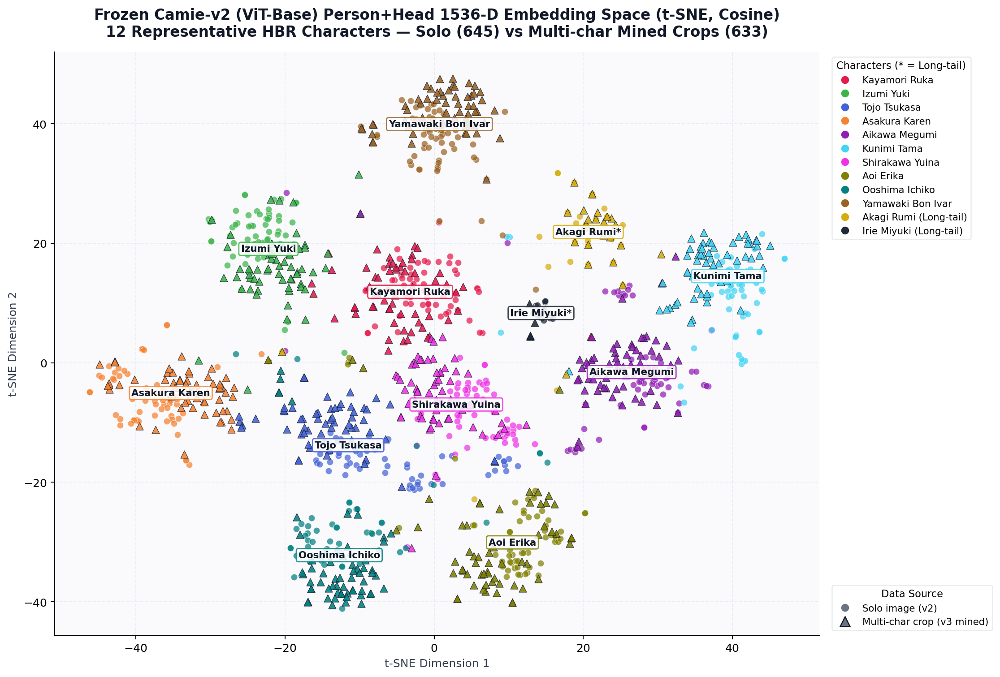
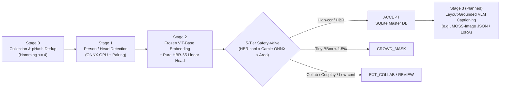

# HBR Generative Dataset Pipeline & Character Classifier

> **이미지 생성 모델(LoRA · MOSS-Image 등 Layout-Conditioned DiT) 학습용 고품질 캐릭터 데이터셋**을 자동 구축하기 위한 End-to-End Vision Pipeline입니다.  
> **헤븐 번즈 레드(Heaven Burns Red)** 55명 캐릭터를 인스턴스(BBox) 단위로 Detection · Classification · Filtering하고, 후속 VLM Captioning까지 일관되게 관리합니다.


---

## Key Results

| Metric | Result | Note |
|---|---|---|
| **55-Class 5-Fold CV (`v3`)** | **99.23%** | Frozen ViT-Base 위 **~630 KB** Linear Probe (CPU 학습 22초) |
| **Long-Tail 개선 (`akagi_rumi`)** | **79.31% → 87.72%** (+8.41%p) | Multi-character crop 4,198장 자동 마이닝 후 재학습 |
| **자동 정제 규모 (`Master DB`)** | **10,903장 / 22,665 BBox** | pHash 중복 717장 자동 제거 · `ACCEPT` 7,173장 확보 |
| **Open-Set 노이즈 격리** | **5-Tier Safety-Valve** | 콜라보 · 코스프레 · 배경 군중(`CROWD_MASK`) · 미학습 OOD 자동 분리 |

> **설계 원칙 — Precision-First for Generative Training**  
> 본 프로젝트의 목표는 모든 이미지를 억지로 100% 분류하는 것이 아니라, **이미지 생성 모델 학습에 바로 쓸 수 있는 오염 없는 데이터셋을 확보하는 것**입니다. 캐릭터 정체성이 드러나지 않는 특정 부위 컷(손·발·소품)이나 극단적 뒷모습·모호한 구도는 억지로 자동 라벨링할 경우 생성 모델의 **Concept Bleeding(개념 오염)**을 유발할 수 있어, 의도적으로 `NO_BOX` / `REVIEW`로 분리해 수동 선별(또는 학습 제외)하도록 설계했습니다.



---

## 1. Problems & Deep-Dive Case Studies

실제 일러스트 1만여 장으로 캐릭터 데이터셋을 자동 구축하면서 해결한 **3가지 핵심 문제**입니다. 각 항목의 상세 분석과 시각화 예시는 `docs/problems/`에 별도로 정리했습니다.

| # | 문제 정의 | 핵심 해결 전략 | 상세 문서 & 예시 |
|---|---|---|---|
| **1** | **이미지 단위 태그의 한계**<br>다인 씬에서 "누가 어디에 있는지" 알 수 없어 VLM Captioning 정합성 및 **MOSS-Image** 같은 BBox-grounded 생성모델 학습 포맷 구성 불가 | `Person / Head Detection` + Hungarian 1:1 매칭으로 인스턴스별 BBox와 캐릭터 ID를 SQLite에 구조화 → JSON 레이아웃 캡셔닝 직결 | [01. BBox & Layout Captioning →](docs/problems/01_bbox_and_layout_captioning.md) |
| **2** | **Open-Set 노이즈 혼입**<br>콜라보 캐릭터 · 타 작품 코스프레 · 배경 군중 · 엑스트라 및 데이터 부족으로 학습에서 제외된 캐릭터가 혼재 (`_other` 클래스는 HBR 확률 잠식) | 순수 HBR-55 + 원본 Camie-v2 ONNX Tagger 교차 검증 + BBox 면적 필터 기반 **5-Tier Safety-Valve** 도입 | [02. Open-Set Safety-Valve →](docs/problems/02_open_set_safety_valve.md) |
| **3** | **Long-Tail 클래스 불균형 & 검증**<br>소수 캐릭터는 솔로 이미지가 20~30장 수준에 불과해 일반화·과적합 문제 발생 | Frozen ViT-Base Linear Probe + 다인 크롭 4,198장 자동 마이닝(`v3`) + **Grad-CAM** XAI로 Attention 및 실패 원인 검증 | [03. Long-Tail & Grad-CAM XAI →](docs/problems/03_long_tail_and_xai.md) |
| **★** | **고차원 임베딩 분포 & 분리도 검증**<br>630 KB Linear Probe의 구조적 근거, 닮은 쌍(Cosine ~0.91) 분리도, `_other` 분산 및 전수 OOF 오분류 분석 | 2D t-SNE (`Solo` vs `Multi`, `_other`) + 1,536-D 5-Fold OOF 초평면 결정 마진(99.6~100%) 정량 검증 | [Embedding Space Analysis →](docs/analysis/embedding_space.md) |

---

## 2. Pipeline Architecture



---

## 3. Iteration & Benchmark (v1 → v2 → v3)

| Version | Classes | Training Data | 5-Fold CV (`person+head`) | `akagi_rumi` CV | Key Change |
|---|---:|---|---:|---:|---|
| **v1** | 54 | Solo 1,053장 | 97.53% | — | 초기 프로토타입 |
| **v2 (`+_other`)** | 56 | Solo + `_other` 4,510장 | 96.90% | 79.31% | `_other`가 HBR 확률을 잠식하는 한계 확인 |
| **v2 (Pure)** | 55 | Pure HBR-55 Solo 4,345장 | — | — | `_other` 제거 + 5-Tier Safety-Valve 도입 |
| **v3 (Final)** | **55** | **Solo 4,345 + Multi-char 4,198장** | **99.23%** | **87.72%** | 다인 크롭 자동 마이닝으로 정확도·소수 클래스 동시 개선 |

**SQLite Master DB (`data/db/master_hbr.db`) 현황**:
- **Images**: 10,903장 (Unique 10,186 / Duplicate 717) — `ACCEPT` 7,173 · `REVIEW` 2,880 · `COSPLAY` 113 · `NO_BOX` 20
- **BBoxes**: 22,665개 — `ACCEPT` 15,264 · `REVIEW` 5,157 · `CROWD_MASK` 2,239 · `REVIEW_COSPLAY_OR_EXT` 5

---

## 4. Project Structure

```text
.
├── docs/
│   ├── problems/            # 핵심 문제별 상세 분석 문서 (01 ~ 03)
│   ├── analysis/            # 임베딩 분포 · 1,536-D 결정 경계 · 전수 OOF 분석
│   └── assets/              # BBox · Safety-Valve · t-SNE · Margin · Grad-CAM 시각화 예시
├── src/hbr_pipeline/        # 핵심 라이브러리 (detector, classifier, phash, db)
├── scripts/
│   ├── collect/             # Danbooru 메타·이미지 수집 CLI
│   ├── pipeline/            # DB 빌드 · 신규 이미지 적재 · 폴더 Inference · v3 학습 · HF 배포
│   └── eval/                # hard_testset 벤치마크 · Grad-CAM XAI 분석
├── models/                  # v3 Linear Probe weights (~630 KB)
├── data/                    # 로컬 DB · 원본 이미지 · 임베딩 · 평가셋 (Git 제외, HF 백업)
└── outputs/                 # Inference 시각화 · Grad-CAM 전체 산출물 (Git 제외)
```

---

## 5. Quick Start

```bash
python -m venv .venv
source .venv/bin/activate        # Windows: .\.venv\Scripts\Activate.ps1
pip install -r requirements.txt
```

```bash
# 1) 임의 폴더 Inference + BBox 시각화
python scripts/pipeline/predict_folder.py --input-dir data/test_sets/neo2 --out-dir outputs/eval_v3/neo2

# 2) 신규 이미지를 5-Tier Safety-Valve + pHash 중복제거 거쳐 Master DB 적재
python scripts/pipeline/ingest_images.py --input-dir data/test_sets/neo --source official

# 3) Master DB 통계 조회
python scripts/pipeline/db_cli.py --stats --top-chars 20
```

<details>
<summary><b>세부 CLI 명령어 (v3 재학습 · Evaluation · Grad-CAM · Hugging Face 복원)</b></summary>

```bash
# v3 Linear Head 재학습 (CPU ~22초)
python scripts/pipeline/train_v3.py \
  --v2-embs data/embeddings/v2_solo_embeddings.npz \
  --multi-embs data/embeddings/danbooru_multi_crops_for_v3.npz \
  --out-weights models/v3_pure_hbr55_plus_multi_camie.npz

# hard_testset (178장) 정량 평가 및 Grad-CAM 분석
python scripts/eval/eval_hard_testset.py --weights models/v3_pure_hbr55_plus_multi_camie.npz
python scripts/eval/gradcam_v3_failures.py
python scripts/eval/compare_gradcam_v1_v3.py
```

**Hugging Face Gated Repo 복원** (`Kamome33/hbr-character-classifier`, `Kamome33/hbr-dataset-master`):
```python
import os
from huggingface_hub import snapshot_download

token = os.environ["HF_TOKEN"]  # 또는 `huggingface-cli login`
snapshot_download("Kamome33/hbr-character-classifier", repo_type="model", local_dir="models", token=token)
snapshot_download("Kamome33/hbr-dataset-master", repo_type="dataset", local_dir="data/db", token=token)
```

</details>
