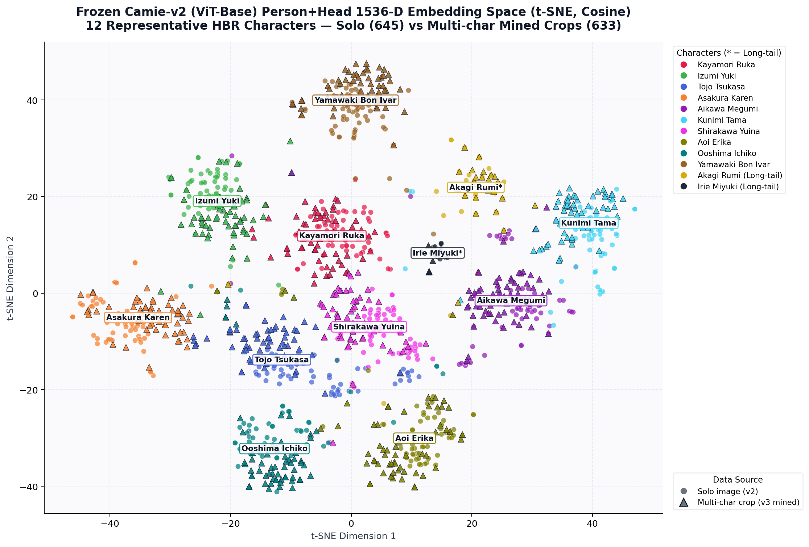
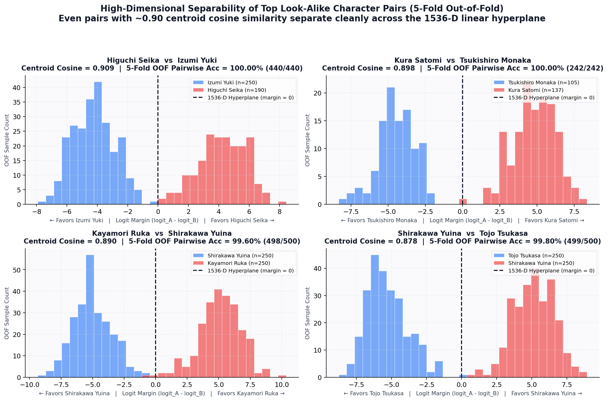
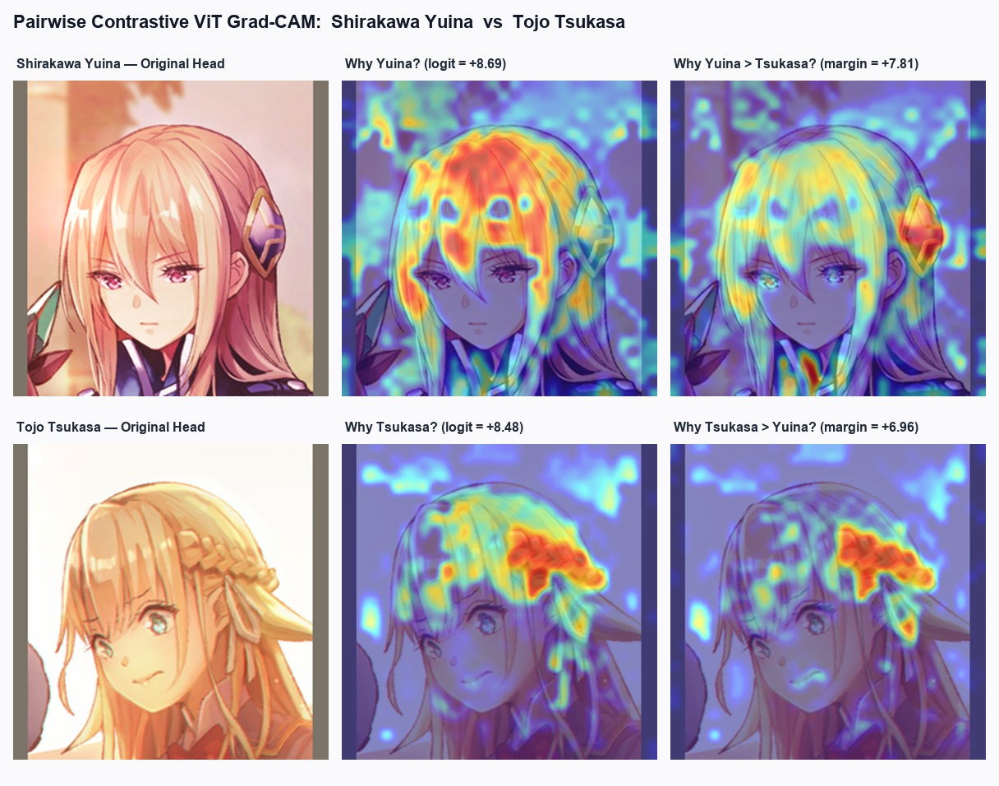
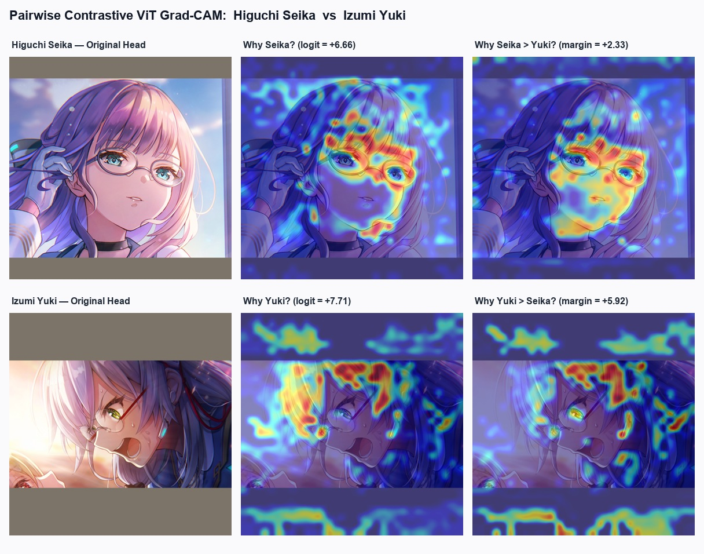
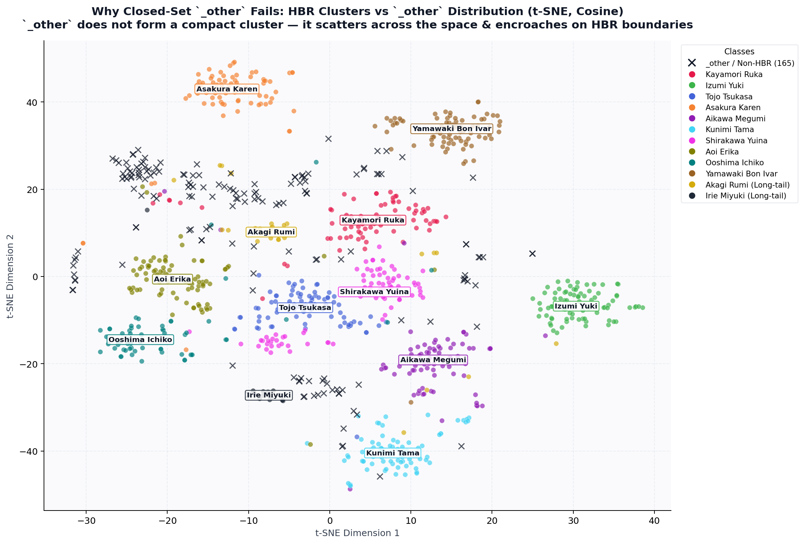

# Embedding Space & High-Dimensional Separability Analysis

Frozen `Camie-v2` (ViT-Base, 86M)의 `person + head` **1,536-D Embedding** 공간이 실제로 어떤 구조를 갖고 있는지, **2D t-SNE → 1,536-D 선형 초평면 정사영 → 55개 클래스 전수 5-Fold OOF 감사 → Open-Set `_other` 분산** 순서로 검증한 결과입니다.

---

## 1. 2D t-SNE 군집 분포 (`Solo` vs `Multi-char Crop`)

55명 중 31A 6명, 인기 캐릭터, Long-tail 대표(`akagi_rumi*`, `irie_miyuki*`) 등 **12명(1,278개 샘플)**을 선별해 Cosine metric t-SNE로 투영했습니다.

- **Frozen Backbone의 표현력**: 백본을 전혀 파인튜닝하지 않았음에도, 애니메이션 도메인에 사전학습된 `Camie-v2` 임베딩 공간에서 캐릭터별로 또렷한 군집(Cluster)이 이미 형성되어 있습니다. 이것이 **~630 KB Linear Probe만으로 5-Fold CV 99.23%**가 나오는 구조적 근거입니다.
- **Multi-char 마이닝 크롭의 정합성**: v3에서 Danbooru 다인 일러스트로부터 자동 마이닝한 크롭(`▲`)이 기존 솔로 군집(`○`) 내부에 정확히 안착해, `akagi_rumi*`·`irie_miyuki*` 같은 소수 클래스의 분포를 안정적으로 보강합니다.



---

## 2. 고차원(1,536-D) 결정 경계 검증: 닮은 쌍도 실제로 분리되는가?

2D t-SNE는 1,536차원을 평면으로 압축하기 때문에 `Shirakawa Yuina`와 `Tojo Tsukasa`처럼 일부 군집이 겹쳐 보일 수 있습니다. 실제 고차원 분리도를 확인하기 위해 **중심 코사인 유사도 최상위 닮은 쌍 4개**를 대상으로, `v3` Linear Head의 결정 초평면($\text{logit}_A - \text{logit}_B = 0$) 위로 **5-Fold Out-of-Fold(검증셋)** 샘플을 정사영했습니다.

| 캐릭터 쌍 | Centroid Cosine Sim | 5-Fold OOF Pairwise Acc | 비고 |
|---|---:|---:|---|
| **`higuchi_seika` vs `izumi_yuki`** | **0.909** (전체 1위) | **100.00%** (440/440) | 흑발·안경 계열 최고 유사 쌍 |
| **`kura_satomi` vs `tsukishiro_monaka`** | **0.898** (전체 2위) | **100.00%** (242/242) | `MonakaHospital` 경합 페어 |
| **`kayamori_ruka` vs `shirakawa_yuina`** | **0.890** (전체 3위) | **99.60%** (498/500) | 2D t-SNE 중앙 인접 쌍 |
| **`shirakawa_yuina` vs `tojo_tsukasa`** | **0.878** | **99.80%** (499/500) | 2D t-SNE에서 일부 겹쳐 보였던 쌍 |



### Pairwise Contrastive Grad-CAM: 닮은 두 캐릭터를 실제로 "어디"를 보고 가르는가?
`v3` 가중치의 차이 벡터($\Delta w = w_A - w_B$)에 Grad-CAM을 적용해, 유사도가 높은 두 캐릭터를 구분할 때 모델이 실제로 주목하는 픽셀 영역을 확인했습니다.

- **`Shirakawa Yuina` vs `Tojo Tsukasa`**: 둘 다 유사한 톤의 장발이지만, 모델은 **유이나의 육각형 옆머리핀** vs **츠카사의 옆머리 땋은 머리·리본**에 정확히 집중해 `99.80% (499/500)`로 분리합니다.
- **`Higuchi Seika` vs `Izumi Yuki`**: 둘 다 안경 캐릭터지만, 세이카의 **타원형 안경·초커·앞머리 윤곽** vs 유키의 **안경 브릿지·눈매·옆머리 리본** 차이를 포착해 `100.00% (440/440)`로 분리합니다.




---

## 3. 55개 클래스 전수 5-Fold OOF 감사 (In-Distribution vs OOD)

전체 8,543장(55개 클래스, $\binom{55}{2}=1,485$개 모든 쌍)의 5-Fold Out-of-Fold 혼동 행렬을 전수 점검한 결과입니다.

- **전반적 분리도**: 전체 8,543장 중 오분류는 **63장(99.26%)**에 불과하며, **55명 중 54명이 97.03% ~ 100.00%**로 분리됩니다.
- **최다 혼동 쌍**: 가장 많이 헷갈린 쌍조차 단 **3건**(`akagi_rumi → higuchi_seika`)이며, 그 외에는 전부 1~2건 수준입니다.
- **유일한 약점 클래스 — `akagi_rumi` (87.72%, 50/57)**:
  - Danbooru 내 샘플 수 자체가 워낙 적어(초기 솔로 29장) `Camie-v2` 사전학습 단계에서 표현이 상대적으로 덜 응집된 유일한 클래스입니다. v3 다인 크롭 보강으로 `79.31% → 87.72%`까지 개선했습니다.
- **In-Distribution vs Out-of-Distribution 시사점**:
  - Danbooru 스타일(In-Distribution)에서는 1,536-D 임베딩이 거의 완벽하게 분리됩니다.
  - 반면 실제 오탐은 **공식 스토리 스틸컷의 특수 조명, 파격 의상, 트레이드마크 누락(안경 미착용 등)**처럼 도메인 시프트(OOD)가 발생할 때 주로 생기므로, 별도 평가셋(`neo`, `neo2`, `hard_testset`)과 [Grad-CAM XAI](../problems/03_long_tail_and_xai.md) · [5-Tier Safety-Valve](../problems/02_open_set_safety_valve.md)로 이 갭을 통제하는 구조가 필수적입니다.

---

## 4. Open-Set `_other` 분포 (왜 단일 클래스로 묶을 수 없는가?)

v2 초기 실험에서 비-HBR 인물을 56번째 클래스 `_other`로 묶었을 때 전체 CV가 오히려 하락(`97.53% → 96.90%`)한 원인을 t-SNE로 확인했습니다.

- `_other`(`×`, 165개)는 단일 군집을 이루지 못하고 공간 전역에 흩어져 `akagi_rumi`, `irie_miyuki`, `aoi_erika` 등 HBR 군집 경계를 침범합니다.
- 이 분석을 근거로 `_other` 클래스를 제거하고 순수 HBR-55 + **5-Tier Safety-Valve** 구조로 전환했습니다 ([상세 설계 →](../problems/02_open_set_safety_valve.md)).



---

### 재현 명령어
```bash
python scripts/eval/visualize_embeddings.py --out-dir outputs/embeddings
```
