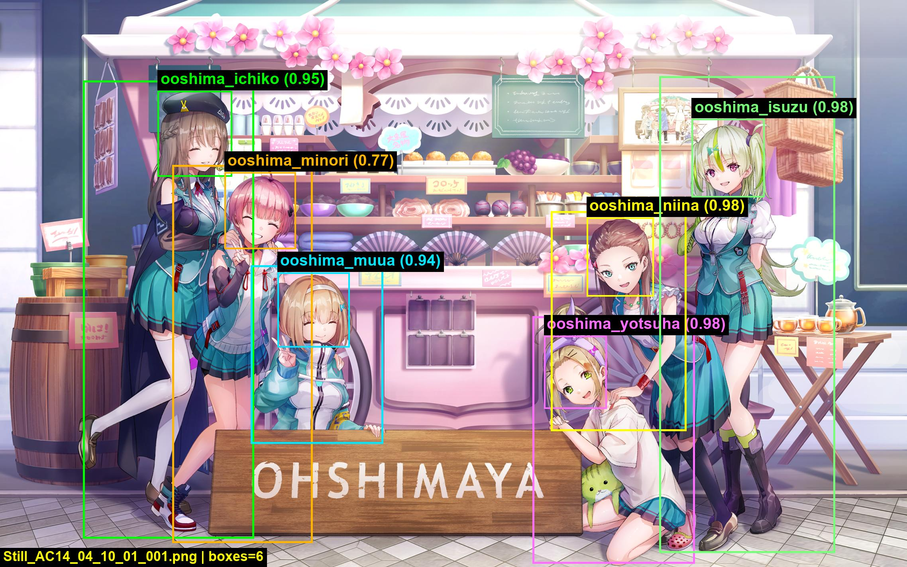

# Problem 1: 왜 Instance-level BBox인가? (Layout-Conditioned Generation & VLM Captioning)

## 1. 문제 배경

### 기존 이미지 단위(Image-level) 태그의 한계
Danbooru 메타데이터나 기존 이미지 태거(WD14, Camie-v2 등)는 **"이 그림에 캐릭터 A, B, C가 등장한다"**는 이미지 단위 목록만 제공할 뿐, **각 캐릭터가 화면의 어느 좌표(BBox)에 있는지**는 알 수 없습니다.

다인 일러스트에서 공간 매핑이 없으면 두 가지 병목이 생깁니다:
1. **VLM Captioning 정합성 붕괴**: 다인 씬에서 VLM에 이미지와 캐릭터 이름 목록만 넘기면, 어떤 인물이 누구인지 혼동해 외형·복장·행동 묘사가 뒤섞입니다.
2. **차세대 Layout-Conditioned 생성모델 대응 불가**: 최근 [OpenMOSS/MOSS-Image](https://github.com/OpenMOSS/MOSS-Image)와 같은 5B DiT 기반 생성모델은 단순 평문 프롬프트를 넘어, **장면 요약(`summary.caption`) + 객체별 위치·캡션(`items[].bbox`, `items[].caption`)을 구조화된 JSON 레이아웃으로 직접 입력받아 학습·생성**하는 방향으로 진화하고 있습니다. 기존 평면 태그 데이터셋으로는 이러한 BBox-grounded 학습 포맷을 만들 수 없습니다.

---

## 2. 해결 설계

1. **Stage 1 (`Person / Head Detection` + Pairing)**
   - ONNX `anime_person_detection` + `anime_head_detection`으로 모든 인물의 전신(`person_bbox`)과 머리(`head_bbox`)를 검출하고 1:1 페어링합니다.
2. **Stage 2 (Instance-level Classification & Hungarian Matching)**
   - 각 인스턴스의 `person + head` 1536-dim Embedding으로 캐릭터를 확정합니다. (Danbooru 메타데이터가 있는 경우 Hungarian 1:1 매칭을 결합)
3. **Stage 3 연결 (Structured Layout Captioning → MOSS-Image 포맷 호환)**
   - `master_hbr.db`의 `boxes` 테이블(`character`, `person_bbox_json`, `tier`)을 기반으로 VLM이 인물별 캡션을 생성하면, 아래와 같이 **MOSS-Image 학습/추론용 JSON 레이아웃 스키마**(`yxyx` / `abs_centralized`)로 바로 변환할 수 있습니다.

```json
{
  "summary": {
    "meta": ["anime illustration", "multi-character"],
    "canvas": "single",
    "caption": "Six sisters of the Ooshima family gathered together in a bright room."
  },
  "items": [
    {
      "label": "object",
      "caption": "ooshima_ichiko smiling in the center-left...",
      "bbox": [-210, -320, 340, -80]
    },
    {
      "label": "object",
      "caption": "ooshima_niina standing beside her...",
      "bbox": [-195, -60, 350, 180]
    }
  ],
  "bbox_coord_space": "abs_centralized",
  "bbox_format": "yxyx"
}
```

---

## 3. 실제 적용 예시 (6인 동시 Detection + Classification)

6명의 캐릭터가 한 화면에 등장하는 공식 일러스트에서도 각 인물의 BBox와 캐릭터 ID(`ACCEPT`, `conf 0.77~0.98`)를 1:1로 정확히 분리합니다.


- `Still_AC14_04_10_01_001`: `ooshima_ichiko` (0.95), `ooshima_minori` (0.77), `ooshima_muua` (0.94), `ooshima_yotsuha` (0.98), `ooshima_niina` (0.98), `ooshima_isuzu` (0.98) — **6명 전원 `ACCEPT`**
