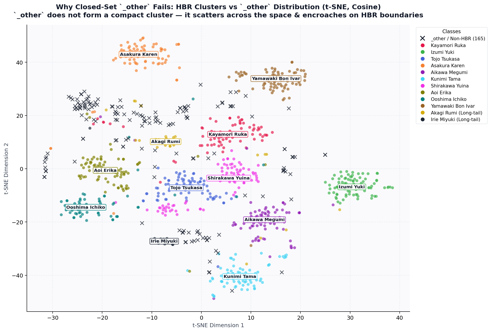
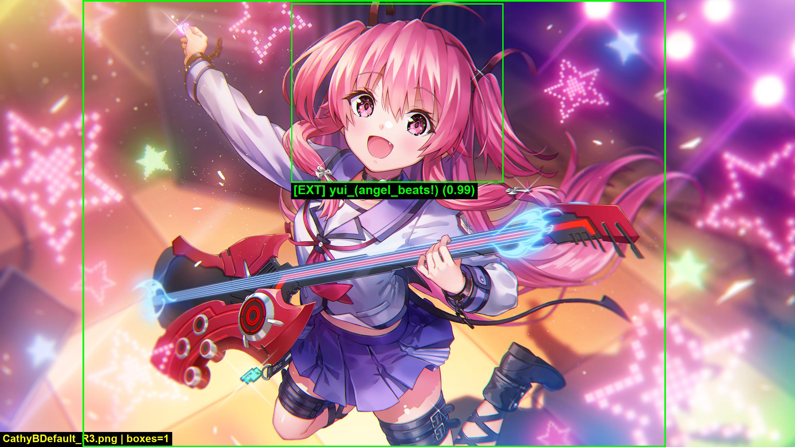
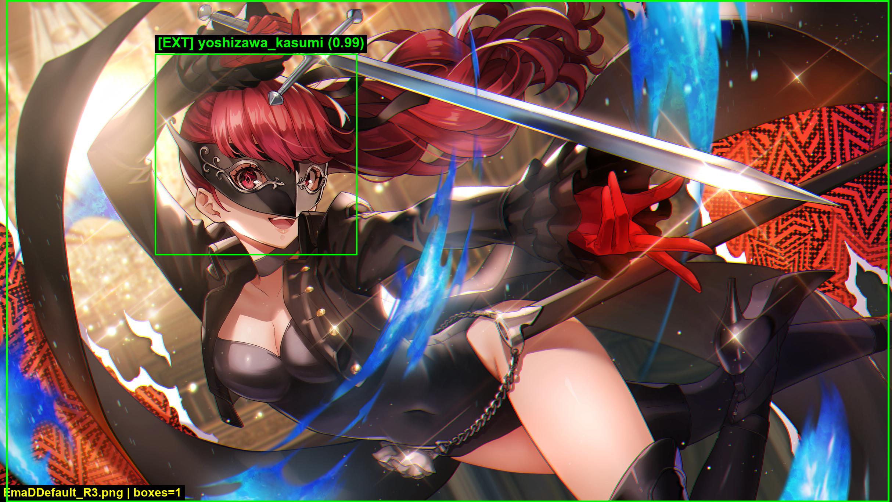
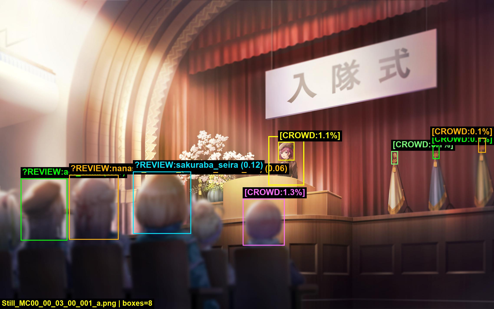
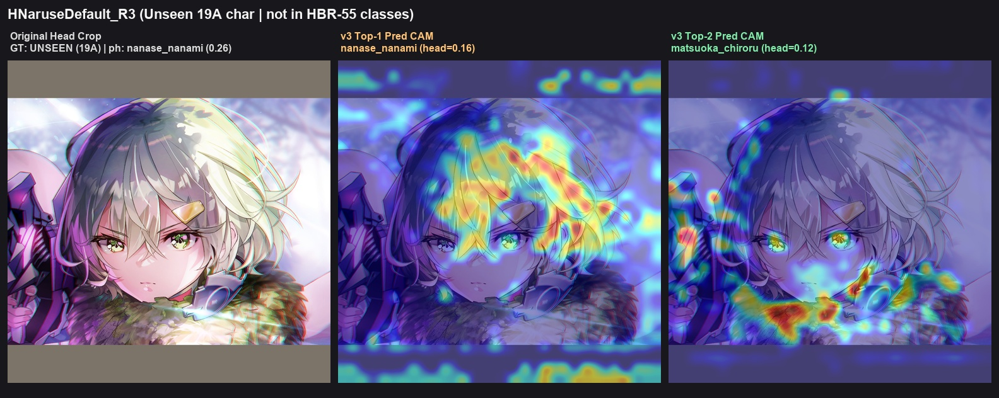

# Problem 2: Open-Set 노이즈 격리 (콜라보 · 코스프레 · 배경 군중 · 엑스트라/신규 캐릭터)

## 1. 문제 배경

실제 수집된 HBR 관련 이미지 10,903장에는 학습 대상인 55명 외에 다양한 **Open-Set 케이스**가 섞여 있습니다:
- **외부 콜라보 및 Key 타 작품 캐릭터**: HBR 자체가 Key(마에다 준) 작품인 특성상, Angel Beats! · Summer Pockets · CLANNAD 등 Key 계열 작품과 Persona 콜라보 캐릭터가 **공식 일러스트와 팬아트 모두에서 HBR 캐릭터와 한 화면에 함께 등장하는 경우가 빈번**합니다. 이미지 통째로 버리면 같이 나온 HBR 캐릭터까지 유실되므로, 인스턴스(BBox) 단위로 외부 캐릭터만 분리해야 합니다.
- **배경 군중(초소형 인물)**: 화면 구석의 모브/군중 BBox (억지 분류 시 오라벨링 유발, 학습 시 마스킹 필요)
- **엑스트라 및 데이터 부족 미학습 HBR 캐릭터**: 작품 내 이미 등장하지만 Danbooru·공식 이미지 샘플 자체가 극히 적어 현재 55-class 학습셋에 넣기 어려운 캐릭터(예: `19A` / `HNaruse`). 콜라보와 달리 **결국 HBR 소속 캐릭터**이므로, 오분류를 막되 DB에 BBox를 보존해 두어 **향후 데이터가 쌓였을 때 손쉽게 신규 클래스로 편입·재학습할 수 있게 준비**하는 것이 목적입니다.
- **타 작품 코스프레 / 비정형 의상 변형**: 외부 캐릭터 의상을 입은 팬아트 또는 이질적 복장

### 실패한 첫 번째 시도: `_other` 클래스 추가 (v2)
처음에는 비-HBR 인물을 걸러내기 위해 56번째 클래스 `_other`를 학습시켰습니다(`v2_full_camie_hbr55_plus_other.npz`).
- **결과**: `_other` 클래스 자체 CV가 **72.12%**에 그쳤을 뿐 아니라, 화풍이 다르거나 구도가 어려운 **정상 HBR 캐릭터의 확률까지 `_other`가 잠식**해 전체 5-Fold CV가 하락(`97.53% → 96.90%`)하는 부작용이 발생했습니다.
- **임베딩 분포 원인 분석**: 아래 t-SNE 분포에서 확인되듯 `_other`(`×`)는 하나의 밀집 군집을 이루지 못하고 공간 전역에 흩어져 `akagi_rumi`, `irie_miyuki`, `aoi_erika` 등 HBR 군집 경계를 침범합니다. 선형 분류기(Linear Probe)에서 이렇게 분산된 Open-Set을 단일 클래스로 묶는 것은 구조적 한계가 명확했습니다.

---

## 2. 해결 설계: Pure HBR-55 + 5-Tier Safety-Valve Routing

`_other` 클래스를 제거한 **순수 HBR-55 분류기**로 복귀하고, 대신 **3가지 신호(HBR 분류기 신뢰도 `conf` · 원본 Camie-v2 ONNX 태거 확률 `eprob` · BBox 면적 비율 `area_pct`)**를 조합한 **5-Tier Safety-Valve**(`src/hbr_pipeline/classifier.py`)로 Open-Set을 분리했습니다.

| Tier | 조건 | 처리 방식 |
|---|---|---|
| **`CROWD_MASK`** | `area_pct < 1.5%` | 배경 군중·초소형 인물 → 분류 제외, 학습 마스킹용 좌표만 보존 |
| **`EXT_COLLAB`** | `conf < 0.45` & `eprob >= 0.70` & `etag ∈ ext_whitelist` | 알려진 콜라보 캐릭터(`EXT:<tag>`)로 자동 태깅 |
| **`REVIEW_COSPLAY_OR_EXT`** | `conf < 0.60` & `eprob >= 0.75` & non-HBR (화이트리스트 외) | 타 작품 혼입·코스프레 의심 → 수동 검수 격리 |
| **`ACCEPT`** | `conf >= 0.45` | 고신뢰 HBR 캐릭터 확정 |
| **`REVIEW`** | 나머지 저신뢰 케이스 | 모호한 구도 · 뒷모습 · 데이터 부족 미학습 HBR 캐릭터 → 수동 선별 및 향후 클래스 확장 대기 풀(Pool)로 보존 |

### 왜 특정 부위 컷(`NO_BOX`)이나 극단적 뒷모습(`REVIEW`)은 수동 대응으로 두는가?
이 파이프라인의 최종 목적은 **단순 분류 정확도 100%가 아니라, 이미지 생성 모델(LoRA · MOSS-Image 등) 학습용 고품질 데이터셋 구축**입니다.
- 손·발·소품 등 특정 부위만 클로즈업된 컷이나 정체성이 불분명한 뒷모습은 애초에 캐릭터 학습용 이미지로 부적격인 경우가 많으며, 억지로 캐릭터 라벨을 붙여 자동 편입하면 생성 모델이 해당 캐릭터의 개념을 흐리게 학습하는 **Concept Bleeding**을 유발합니다.
- 따라서 생성 데이터셋에서는 **Recall(모든 이미지를 억지로 통과)보다 Precision(확실한 고품질 데이터만 자동 편입)**이 우선이며, 판별이 애매하거나 학습 부적격 가능성이 높은 컷을 `NO_BOX` / `REVIEW`로 넘겨 **수동 분류·선별(또는 학습 제외)**하도록 의도적으로 설계했습니다.

---

## 3. 실제 적용 예시

### 예시 A: 외부 콜라보 캐릭터 자동 격리 (`EXT_COLLAB`)
순수 HBR-55 분류기만 썼다면 55명 중 하나로 억지 분류되었을 Angel Beats! / Persona 콜라보 캐릭터를 원본 Camie-v2 ONNX 교차 검증으로 정확히 `EXT_COLLAB`으로 분리합니다.

| Angel Beats! (`EXT:yui_(angel_beats!)`, 0.99) | Persona (`EXT:yoshizawa_kasumi`, 0.99) |
|---|---|
|  |  |

### 예시 B: 배경 군중 자동 마스킹 (`CROWD_MASK`)
화면 면적 1.5% 미만의 배경 인물들을 분류 대상에서 자동 제외하고 마스킹용 BBox 좌표만 DB에 보존합니다.

### 예시 C: 데이터 부족 미학습 HBR 캐릭터 보존 (`REVIEW` 대기 풀)
Danbooru·공식 이미지가 극히 적어 현재 55-class에 넣지 못한 HBR 캐릭터(`HNaruse`)는 최고 확률이 `0.261`에 머물러 다른 55명 중 하나로 오분류(`ACCEPT`)되지 않고 `REVIEW` 풀에 보존됩니다. 향후 해당 캐릭터의 데이터가 충분히 축적되면 DB에서 바로 꺼내 56번째 클래스로 손쉽게 확장·재학습할 수 있습니다.

