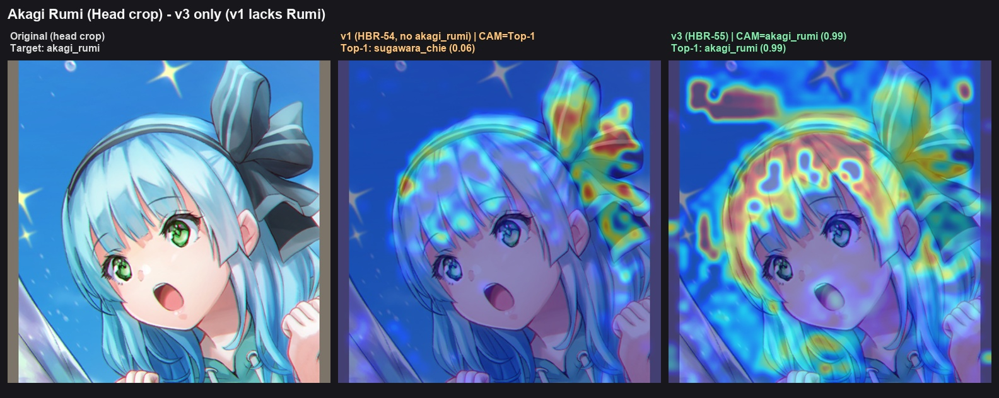
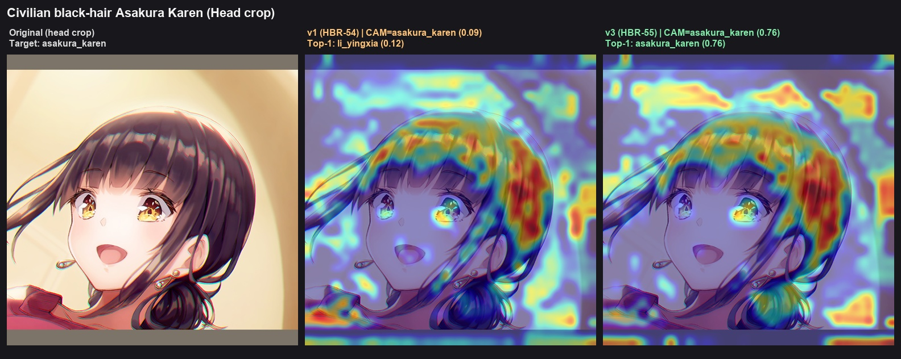
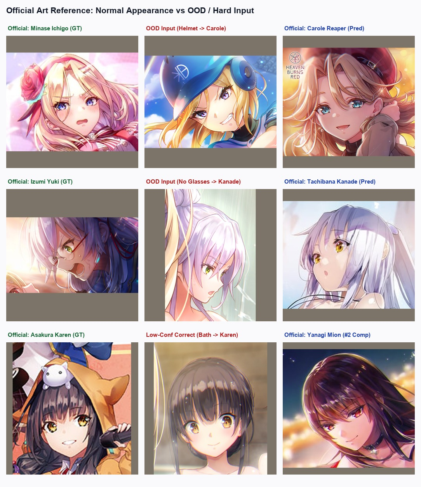
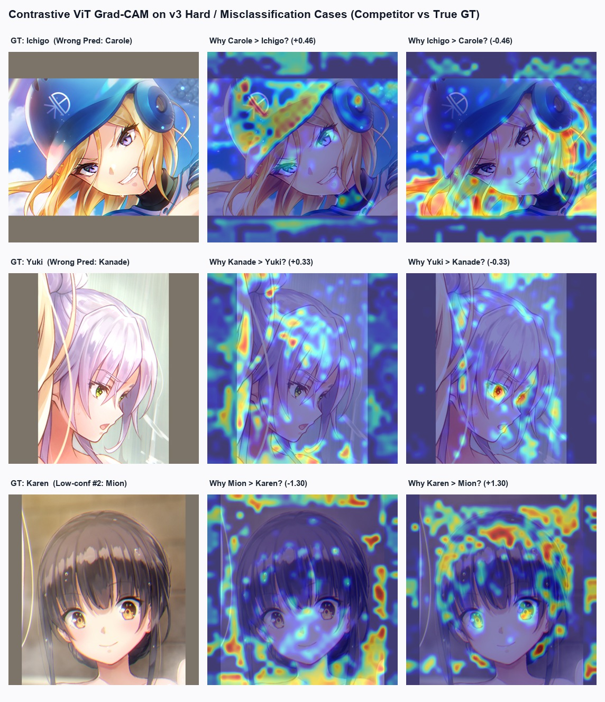

# Problem 3: Long-Tail 클래스 불균형 개선 (v1 → v3) & Grad-CAM XAI 분석

## 1. 문제 배경

- **극심한 클래스 불균형**: 인기 캐릭터는 솔로 일러스트가 수백 장에 달하는 반면, 소수(Long-tail) 캐릭터(예: `irie_miyuki`, `akagi_rumi`)는 솔로 이미지가 **20~30장** 수준에 불과합니다.
- **소수 데이터에서의 과적합 리스크**: 클래스당 샘플이 수십 장 수준일 때 백본 전체를 학습하면 특정 배경이나 의상에 쉽게 과적합됩니다.
- **신뢰성 검증 필요성**: 정량 점수(CV)만 높아진 것인지, 실제로 모델이 캐릭터의 얼굴·헤어 등 본질적 특징에 집중하고 있는지 확인이 필요했습니다.

---

## 2. 해결 설계

1. **Frozen Backbone + `person + head` 1536-dim Linear Probe**
   - 애니메이션 도메인에 사전학습된 `Camie-v2` (ViT-Base, 86M)를 고정하고, L2 정규화 + `class_weight="balanced"` 선형 헤드(~630 KB)만 학습해 소수 클래스 과적합을 억제했습니다.
2. **Multi-Character Crop 자동 마이닝 (`v2 → v3`)**
   - Danbooru 메타데이터와 Hungarian 1:1 매칭으로 다인 일러스트에서 고신뢰 크롭 **4,198장**을 자동 추출해 기존 v2 솔로 데이터(4,345장)와 병합했습니다(`max_per_class=250` 캡 적용).
   - 그 결과 전체 5-Fold CV는 **99.23%**까지 상승했고, `akagi_rumi`는 샘플 29장 → **57장**으로 확장되며 CV가 **79.31% → 87.72% (+8.41%p)** 개선되었습니다.
3. **Grad-CAM XAI 검증 (`scripts/eval/compare_gradcam_v1_v3.py`, `gradcam_v3_failures.py`)**
   - ViT-Base 마지막 블록(`blocks[-1].norm1`)의 Grad-CAM을 시각화하여 v1 대비 v3의 Attention 변화와 v3 잔여 실패 케이스 8건의 원인을 분석했습니다.
   - *(Frozen ViT-Base 1,536-D 임베딩 군집 및 닮은 쌍 초평면 분리도 분석은 [Embedding Space Analysis](../analysis/embedding_space.md)에 별도로 정리되어 있습니다.)*

---

## 3. Grad-CAM 시각적 검증 예시

### 예시 A: v1 → v3 개선 사례 (Attention 집중도 및 신뢰도 상승)
- **`akagi_rumi`**: v1(미포함, `sugawara_chie` 0.062 오분류) → v3 **`akagi_rumi` 0.9894** 정확 분류
- **`asakura_karen`**: v1(`li_yingxia` 0.123 오분류) → v3 **`asakura_karen` 0.7567** 정확 분류

| `akagi_rumi` (v1 → v3: 0.9894) | `asakura_karen` (v1 0.087 → v3 0.7567) |
|---|---|
|  |  |

### 예시 B: v3 오탐·저신뢰 사례 — 평소 외형 비교 & Contrastive Grad-CAM (`Competitor` vs `True GT`)
작품을 모르는 리뷰어도 한눈에 납득할 수 있도록 **평소 정답 캐릭터(좌) · OOD/고난도 입력(중) · 비교 대상 캐릭터(우)**의 실제 외형을 먼저 나란히 두고, 이어서 **Contrastive Grad-CAM (`Why Competitor > GT` vs `Why GT > Competitor`)**으로 모델이 실제로 어느 부위에 반응했는지 확인했습니다:

1. **`IMinaseHR_R3` (`minase_ichigo` → `carole_reaper` 오탐, margin `+0.46`)**: 둘 다 금발 계열인 상태에서 **파란 야구 헬멧·챙**이 `Carole`로 밀었고, 아래로 흩날리는 **금발 머리카락**은 `Ichigo`로 당기며 접전.
2. **`Still_MC05B_05_09_00_003` (`izumi_yuki` 안경 미착용 → `tachibana_kanade` 오탐, margin `+0.33`)**: 연보라·은발 계열 머리의 유키가 안경을 벗자 **밝은 연보라 머리카락**이 `Kanade` 쪽으로 미세하게 앞섰지만, `Yuki > Kanade` CAM은 안경 없이도 **유키 고유의 초록 양쪽 눈매**에 정밀하게 반응함 (`+0.33` 근소한 차이로 `REVIEW` 격리).
3. **`Still_MC03_08_10_00_002` (`asakura_karen` 목욕씬 저신뢰 정답, `#2 yanagi_mion` 대비 margin `+1.30`)**: 시그니처 주황 후드 없이 어두운 머리·노란 눈만 드러난 상황에서 `REVIEW`(`0.19`)로 보수적 격리되었지만, `Karen > Mion` CAM은 **카렌 고유의 일자 앞머리·노란 눈**을 정확히 포착해 Top-1은 정답을 유지함.

